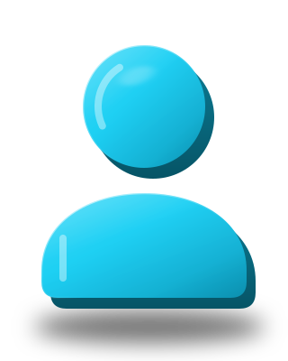
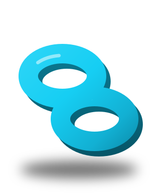

<!-- BANNER -->

  
  
  
  
  

---

<h3>&nbsp; Hi, I'm Shakil</h3>

**AI-powered Full-Stack Developer** · 3+ years building production Next.js & Node.js applications. Spec-driven, AI-assisted development, automated testing, high-velocity shipping.

I care about clean architecture, smooth interactions, and shipping work that actually feels good to use.

📫 **shakilahmmed8882@gmail.com** &nbsp;·&nbsp; 📍 **Bangladesh (Remote)**

<h2>&nbsp; About</h2>

Web developer with 3+ years of production experience, currently building Next.js / React / TypeScript apps for a US hospitality client at SpaceCats Tech.
Spec-driven, AI-assisted development with Claude Code - planning to execution loops, automated testing, high-velocity shipping. Exploring RAG & LLM app development, backed by 188+ solved problems and structured problem decomposition.

<h1>&nbsp; Stacks:</h1>

<h1>&nbsp; Stats:</h1>

 

---

<h3>&nbsp; Connect</h3>

  &nbsp;&nbsp;
  &nbsp;&nbsp;
  &nbsp;&nbsp;
  &nbsp;&nbsp;
  &nbsp;&nbsp;
  &nbsp;&nbsp;
  

📌 Open to remote opportunities · full-stack, front-end & back-end roles · Next.js / Node / TypeScript teams.
